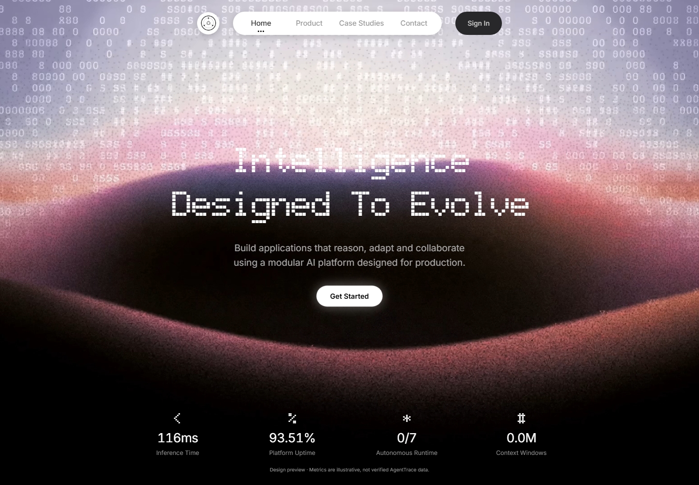
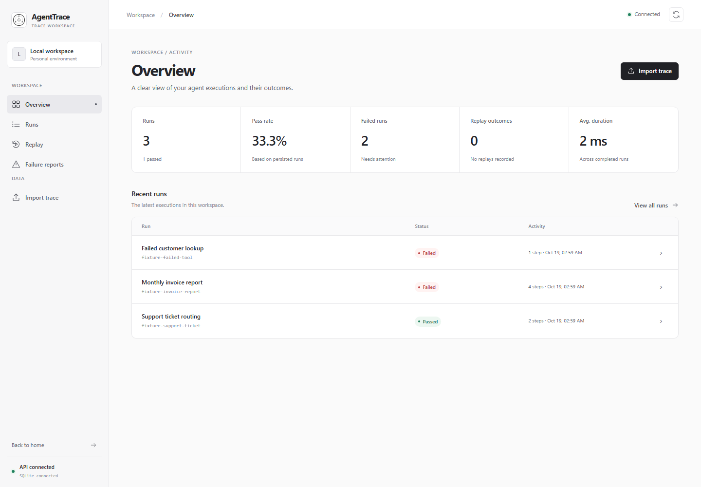
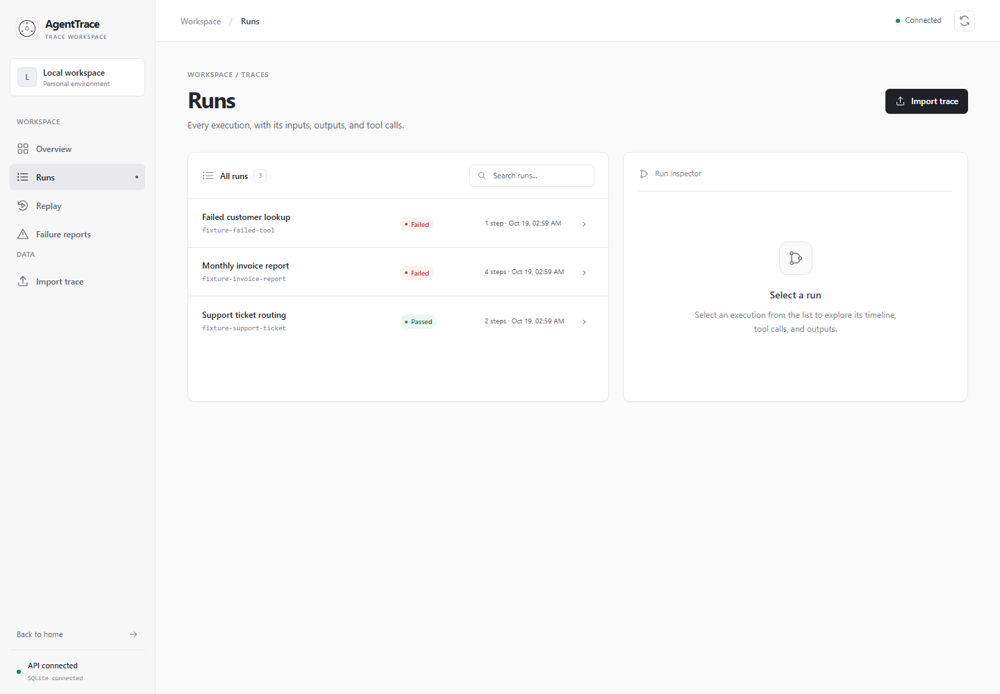
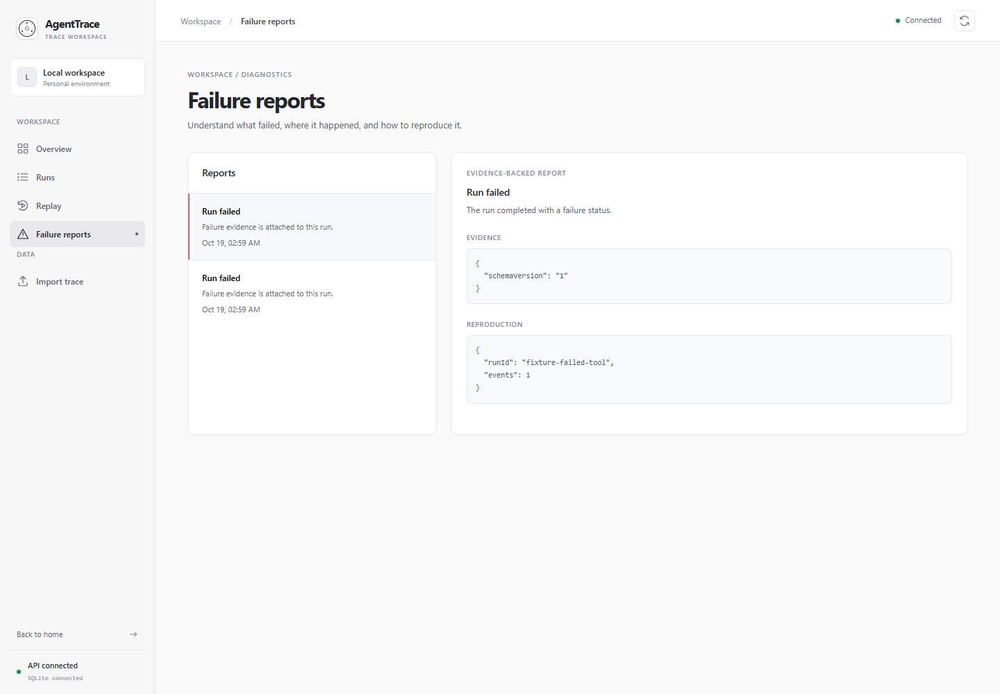
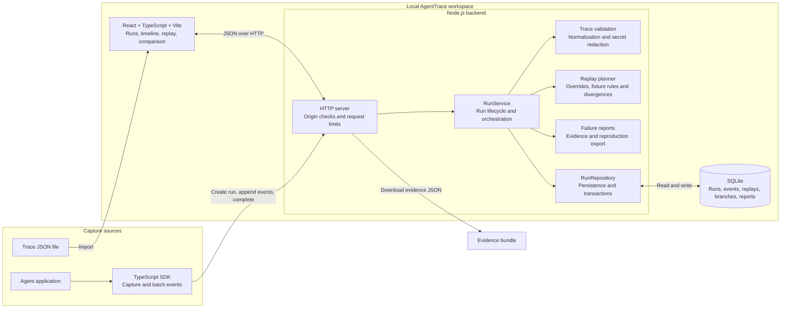
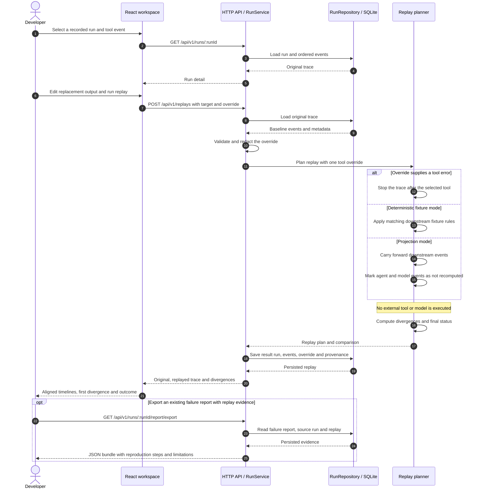
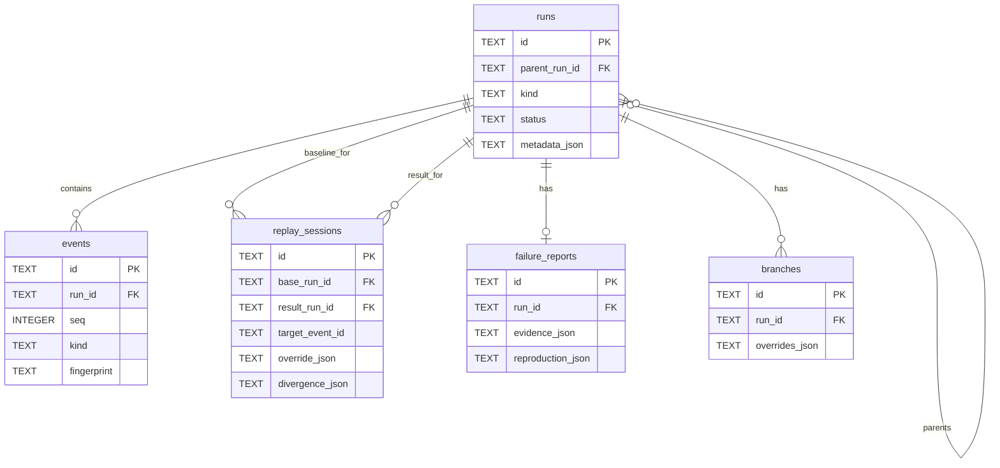

# AgentTrace

**A local-first time-travel debugger for AI agents.**

AgentTrace records structured agent executions, identifies the exact step where a run failed, safely replaces one recorded tool response, and compares the resulting replay with the original trace. Replay uses recorded or mocked data only: it never calls the original external tool.

> Project status: functional local-first MVP. The backend, dashboard, deterministic replay flow, evidence reports, and TypeScript capture SDK are implemented and tested. Authentication and multi-user isolation are intentionally out of scope for the current version.

## Screenshots

### Landing page



### Workspace overview



### Run explorer



### Failure reports



## Why AgentTrace?

An agent run can fail several steps after the real cause. A malformed tool response may alter validation, routing, model context, and the final outcome. Logs show what happened, but usually do not answer: **what would have happened if this one response had been different?**

AgentTrace provides that missing workflow:

1. Capture or import a structured trace.
2. Inspect every agent, model, tool, log, and error event.
3. Select exactly one recorded tool response.
4. Replace it with controlled JSON—without executing the external tool.
5. Replay deterministic downstream fixtures.
6. Compare the original and replayed traces step by step.
7. Export an evidence bundle with reproduction steps and explicit limitations.

## Highlights

- Local SQLite persistence with no required cloud service
- React + TypeScript + Vite inspection workspace
- TypeScript SDK for capturing application-owned agent runs
- Versioned trace validation and preview before import
- Atomic trace and event-batch ingestion
- Automatic redaction of common secrets and credentials
- Controlled single-tool-response replay
- First-divergence and downstream outcome comparison
- Replay provenance and evidence-report export
- Responsive UI with honest empty, offline, and limitation states
- Deterministic backend and SDK tests with no external API calls

## Architecture

### System design

AgentTrace runs as a local Node.js API backed by SQLite, with a React workspace for inspecting and replaying traces. Agent applications send events through the SDK; existing traces can also be imported as JSON.



The backend owns validation, redaction, persistence, replay planning, and reports. In development, Vite proxies `/api` to the backend. In production, the backend serves the built React app and API from one origin.

### Controlled replay sequence

Each replay loads the original trace, applies one selected tool override, and saves a separate result run. The original trace remains available for comparison.



### Persistence model

Runs own ordered events and may reference a parent run. A replay session links the original run to its result run and stores the override and divergences. Branch overrides are stored separately from replay sessions.



## Repository layout

```text
agenttrace/
├── backend/                 Node.js + TypeScript API and SQLite repository
│   ├── fixtures/            Success, failure, and branch-outcome traces
│   ├── migrations/          SQLite schema
│   └── src/                 Domain, repository, service, and HTTP layers
├── frontend/                React + TypeScript + Vite application
│   └── src/                 Pages, components, hooks, and API client
├── sdk/typescript/          Zero-runtime-dependency capture SDK
├── shared/contracts.ts      JSON-safe API contracts
├── Dockerfile               Unified production image
└── Makefile                 Repository-wide checks
```

## Requirements

- Node.js `24.22.0` recommended and pinned in `.nvmrc`
- Node.js `22.5+` minimum for the built-in `node:sqlite` API
- npm
- GNU Make is optional; equivalent npm commands are documented below
- Docker is optional

## Quick start

Install all dependencies from the repository root:

```sh
npm --prefix backend ci
npm --prefix frontend ci
npm --prefix sdk/typescript ci
```

### Development mode

Start the API in terminal 1:

```sh
cd backend
cp .env.example .env
npm run dev
```

On Windows PowerShell, use `Copy-Item .env.example .env` instead of `cp`.

Start Vite in terminal 2:

```sh
cd frontend
npm run dev
```

Open <http://localhost:5173>. Vite proxies `/api` requests to <http://localhost:3000>.

`0.0.0.0` is a server bind address, not a browser destination. Always use `localhost` or `127.0.0.1` in the browser.

### Local production mode

Build both applications, then let the backend serve `frontend/dist`:

```sh
npm --prefix frontend run build
npm --prefix backend run build
cd backend
npm start
```

Open <http://localhost:3000>.

## Run the replay demo

With the backend running, capture a replay-ready trace through the real SDK:

```sh
cd sdk/typescript
npm run example
```

Then:

1. Open <http://localhost:5173/#runs>.
2. Select **SDK invoice replay demo**.
3. Open **Replay**.
4. Select the `fetch_invoice` tool step.
5. Replace its output with:

```json
{
  "amount": 1250,
  "currency": "USD"
}
```

6. Click **Run controlled replay**.

The original run is `failed`; the deterministic replay becomes `passed`. The comparison view highlights the changed tool result, the first downstream divergence, and the new final outcome.

You can also import the bundled fixture from the Import page:

```text
backend/fixtures/invoice-report.json
```

## TypeScript SDK

Build the SDK and install it into a local agent project:

```sh
npm --prefix sdk/typescript run build
npm install /absolute/path/to/agenttrace/sdk/typescript
```

Capture a run:

```ts
import { AgentTrace } from "@agenttrace/sdk";

const trace = new AgentTrace({
  baseUrl: "http://localhost:3000",
  batchSize: 20,
  timeoutMs: 10_000,
});

const run = await trace.startRun({
  name: "Monthly invoice agent",
  metadata: { environment: "development" },
});

try {
  const invoice = await run.tool(
    "fetch_invoice",
    { invoiceId: "inv_42" },
    () => billing.getInvoice("inv_42"),
  );

  await run.record({
    type: "agent",
    name: "generate_report",
    input: invoice,
    output: { generated: true },
  });

  await run.complete();
} catch (error) {
  await run.fail(error);
  throw error;
}
```

The SDK:

- buffers ordered events and writes them in batches;
- records tool output, errors, and duration;
- restores a failed batch to the queue so `flush()` can be retried;
- accepts a custom `fetch` implementation and headers;
- has no production npm dependencies.

`run.tool()` wraps an operation that the host application already intended to execute. AgentTrace does not invoke that operation during replay.

See [sdk/typescript/README.md](sdk/typescript/README.md) for the focused SDK guide.

## Trace format

Schema version `1` accepts an object containing `events` or `steps`, or a raw event array. Missing schema versions are accepted as legacy v1 input with a warning.

```json
{
  "schemaVersion": "1",
  "id": "run-123",
  "name": "Support routing agent",
  "status": "failed",
  "metadata": {
    "environment": "development"
  },
  "events": [
    {
      "id": "lookup-customer",
      "seq": 1,
      "type": "tool",
      "name": "lookup_customer",
      "input": { "customerId": "cus_42" },
      "output": { "tier": "standard" }
    },
    {
      "id": "route-ticket",
      "seq": 2,
      "type": "agent",
      "name": "route_ticket",
      "error": {
        "code": "queue_unavailable",
        "message": "The selected queue is unavailable"
      }
    }
  ]
}
```

Limits:

- Maximum request body: 5 MiB
- Maximum events per imported trace: 10,000
- Maximum JSON nesting depth for redaction: 64
- Event IDs and sequence numbers must be unique within a trace

## HTTP API

Both `/api/...` and `/api/v1/...` forms are supported.

| Method | Endpoint | Purpose |
| --- | --- | --- |
| `GET` | `/api/v1/healthz` | API and SQLite health |
| `GET` | `/api/v1/overview` | Persisted workspace metrics |
| `GET` | `/api/v1/runs` | List and filter runs |
| `POST` | `/api/v1/runs` | Create an active run |
| `POST` | `/api/v1/runs/validate` | Validate, redact, and preview a trace |
| `POST` | `/api/v1/runs/import` | Atomically import a complete trace |
| `GET` | `/api/v1/runs/:runId` | Retrieve a run and ordered events |
| `POST` | `/api/v1/runs/:runId/events` | Append one event or an atomic event batch |
| `POST` | `/api/v1/runs/:runId/complete` | Complete or fail an active run |
| `POST` | `/api/v1/runs/:runId/replay` | Replay one selected tool response |
| `GET` | `/api/v1/replays?runId=:runId` | List replay provenance |
| `GET` | `/api/v1/replays/:replayId` | Retrieve a stored replay record |
| `POST` | `/api/v1/runs/:runId/branches` | Store controlled response overrides |
| `POST` | `/api/v1/runs/:runId/compare` | Compare actual calls with recorded fixtures |
| `GET` | `/api/v1/failures` | List failure reports |
| `GET` | `/api/v1/failures/:runId` | Retrieve a run failure report |
| `GET` | `/api/v1/runs/:runId/report/export` | Download a versioned evidence bundle |

Example replay request:

```sh
curl -X POST http://localhost:3000/api/v1/runs/run-123/replay \
  -H "Content-Type: application/json" \
  -d '{
    "targetEventId": "lookup-customer",
    "override": { "output": { "tier": "vip" } }
  }'
```

Errors use a stable envelope:

```json
{
  "error": {
    "code": "validation_error",
    "message": "targetEventId is required"
  },
  "requestId": "..."
}
```

## Configuration

| Variable | Default | Description |
| --- | --- | --- |
| `PORT` | `3000` | HTTP port |
| `HOST` | `0.0.0.0` | Bind address |
| `AGENTTRACE_DB_PATH` | `./data/agenttrace.sqlite` | SQLite database path, relative to `backend/` |
| `AGENTTRACE_FRONTEND_DIR` | `../frontend/dist` | Built frontend directory |
| `AGENTTRACE_ALLOWED_ORIGINS` | Local Vite origins | Comma-separated browser-origin allowlist |
| `VITE_API_BASE` | Same origin | Optional frontend API base URL |

## Testing

Run everything with GNU Make:

```sh
make typecheck
make test
make build
```

Or run the equivalent commands directly:

```sh
npm --prefix backend run typecheck
npm --prefix backend test

npm --prefix frontend run typecheck
npm --prefix frontend test
npm --prefix frontend run build

npm --prefix sdk/typescript run typecheck
npm --prefix sdk/typescript test
```

The backend suite covers validation, redaction, atomic ingestion, replay success and failure, branch outcomes, provenance, evidence export, and origin controls. The SDK suite covers capture batching and retry behavior. Frontend checks cover routing, API wiring, replay comparison controls, responsive styles, and production compilation.

## Docker

Build from the repository root:

```sh
docker build -t agenttrace .
docker run --rm -p 3000:3000 -v "$(pwd)/data:/app/backend/data" agenttrace
```

PowerShell volume syntax:

```powershell
docker run --rm -p 3000:3000 -v "${PWD}/data:/app/backend/data" agenttrace
```

Open <http://localhost:3000>. The container serves the built frontend and API from one origin.

## Security and privacy

- Trace data stays in the configured local SQLite database.
- Common authorization, token, password, secret, cookie, session, and private-key fields are replaced with `[REDACTED]` before persistence.
- Bearer/basic credential strings and private-key blocks are also redacted.
- Browser origins are deny-by-default except for configured local development origins.
- Import and batch operations validate the complete payload before committing it.
- Replay never executes an arbitrary external tool or model call.

Redaction is defensive and cannot guarantee detection of every custom secret format. Avoid placing unnecessary credentials in traces.

## Replay boundary

AgentTrace provides deterministic replay for recorded tool fixtures and explicitly modeled downstream transitions. It does **not** claim to reproduce:

- arbitrary model generation;
- hidden model state;
- network or service state;
- wall-clock behavior;
- random values that were not recorded;
- side effects outside the captured trace.

Projection-mode replays retain downstream model/agent events and label them as not recomputed. Evidence exports include these limitations so replay results are not presented as stronger proof than they are.

## Current limitations

- No authentication, organizations, or multi-user authorization
- No hosted trace collector or managed storage
- TypeScript SDK only; Python SDK is not implemented yet
- No OpenTelemetry ingestion adapter yet
- `node:sqlite` still emits an experimental warning on supported Node versions
- External landing-page fonts and video require network access; the debugger itself does not

## Troubleshooting

### `.env not found`

The backend continues with safe defaults. Copy `backend/.env.example` to `backend/.env` to remove the warning.

### `ERR_ADDRESS_INVALID` at `0.0.0.0:3000`

Open <http://localhost:3000>. `0.0.0.0` only tells the server to listen on all network interfaces.

### UI says API unavailable

Confirm the health endpoint works:

```sh
curl http://localhost:3000/api/v1/healthz
```

During Vite development, keep both backend port `3000` and frontend port `5173` running.

### Replay still uses old behavior

Restart the backend after rebuilding:

```sh
cd backend
npm run build
npm run dev
```

## License

No license file is currently included. Add an explicit license before distributing or accepting external contributions.
